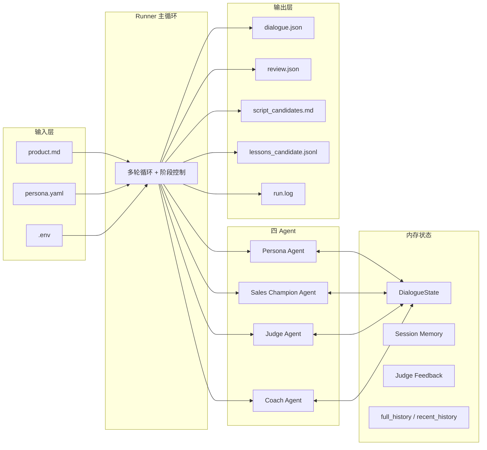
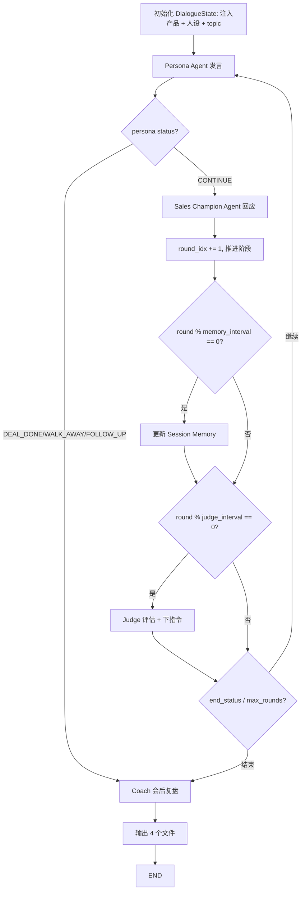

## 一、MVP 范围

**一句话定义**：本地命令行运行的四 Agent 销售模拟引擎，输入产品资料 + 用户人设，输出完整对话与结构化销售资产。

**MVP 必做（P0）**：

- 4 个 Agent：Persona / Sales Champion / Judge / Coach
- 6 阶段销售路径驱动（开场 → 异议 → 挖动机 → 匹配 → 强压 → 收尾）
- 当前会话画像 Session Memory（每 3 轮更新）
- Judge 每 3 轮中场控制（阶段推进 / 指令下发 / avoid_repeating / end_status）
- 命令行运行 + rich 控制台日志
- 输出：`dialogue.json` / `review.json` / `script_candidates.md` / `lessons_candidate.jsonl`

**MVP 不做（明确暂缓，避免变成"长满功能但不会走路的怪物"）**：

- LangGraph（用纯 Python 主循环）
- Chroma / 向量库（product.md 直接读全文 + 截断 5000 字注入）
- SQLite（全 JSON / JSONL / MD 落盘）
- FastAPI / WebSocket / Vue 看板
- 经验自动回写正式库（只生成 candidate，不自动入库）
- 批量并发任务、统计大屏、人工经验审核 UI

这些会在阶段 B-E 逐步加上，第一版只做"发动机能转"。

---

## 二、整体架构




---

## 三、主循环数据流




**结束条件**：达到 `max_rounds` / Persona `status` 非 CONTINUE / Judge `end_status` 非 CONTINUE。

---

## 四、目录结构（平铺在 `f:\Langraph\` 根目录）

```
f:\Langraph\
├── requirements.txt
├── .env.example
├── .env                          # 本地真实 key，不入库
├── README.md
├── mvp_prd_*.md                  # 已有的三份文档保留在根目录
├── mvp_vibe_coding开发文档_*.md
├── 多人设销冠压力测试引擎_最终版蓝图.md
├── data/
│   ├── product.md                # 学习平板产品示例
│   ├── lessons_candidate.jsonl   # 候选经验逐场追加
│   └── sessions/                 # 备份 jsonl（可选）
├── personas/
│   ├── price_sensitive_student.yaml
│   ├── skeptical_parent.yaml
│   └── tech_enthusiast.yaml
├── prompts/
│   ├── persona_prompt.md
│   ├── sales_prompt.md
│   ├── judge_prompt.md
│   ├── coach_prompt.md
│   └── session_memory_prompt.md
├── src/
│   ├── __init__.py
│   ├── config.py                 # load_settings() 读 .env
│   ├── schema.py                 # Pydantic：PersonaProfile / DialogueState / Turn / SessionMemory / JudgeFeedback / CoachReview
│   ├── llm.py                    # call_llm / call_llm_json（OpenAI 兼容）
│   ├── loaders.py                # load_text_file / load_persona_yaml / validate_product_text
│   ├── agents.py                 # generate_persona_turn / generate_sales_turn + prompt 渲染工具
│   ├── memory.py                 # update_session_memory
│   ├── judge.py                  # judge_dialogue
│   ├── coach.py                  # run_coach_review
│   ├── output.py                 # 4 个文件落盘
│   ├── runner.py                 # CLI + run_session 主循环
│   └── utils.py                  # extract_json / strip_code_fence / safe_json_dumps / now_timestamp
└── outputs/
    └── .gitkeep                  # session_YYYYMMDD_HHMMSS_<persona_id>/ 每场一个子目录
```

---

## 五、技术选型

- **语言**：Python 3.10+
- **LLM**：DeepSeek（通过 `openai` SDK 走 OpenAI 兼容接口，`base_url=https://api.deepseek.com`，`MODEL_NAME=deepseekV4-pro`，温度等参数走 .env）
- **依赖**：`openai>=1.0`、`python-dotenv`、`PyYAML`、`pydantic>=2.0`、`rich`
- **不引入**：LangGraph / langchain / chromadb / sentence-transformers / fastapi / sqlalchemy / vue —— 全部留到第二阶段及以后

**全局工程纪律（按 Vibe Coding 文档第 4 节）**：

1. 所有 LLM 输出强制要求 JSON
2. 所有 JSON 解析必须有兜底（提取 / repair / fallback dict）
3. Prompt 全部放 `prompts/*.md`，不硬编码在 .py
4. JSON 解析失败重试一次并强调"只输出合法 JSON"，仍失败返回 fallback 不崩溃
5. API 失败重试 2 次（间隔 2 秒），仍失败保留已生成内容后退出
6. 每场对话写独立 `outputs/session_<时间戳>_<persona_id>/` 目录
7. 中途异常也尽量把已生成 history 落盘

---

## 六、四 Agent 设计要点（详见三份文档对应章节）

**Persona Agent**（`generate_persona_turn`，温度 0.8）

- 注入 `persona_profile` + `pressure_profile` + `stage` + `judge.persona_instruction` + `session_memory` + `recent_history`
- 必须不轻易成交，前 30% 轮次禁止 DEAL_DONE
- 输出 `{content, hidden_state: {intent, attitude, purchase_signal, status}}`，status ∈ {CONTINUE, DEAL_DONE, WALK_AWAY, FOLLOW_UP}

**Sales Champion Agent**（`generate_sales_turn`，温度 0.6）

- 注入 `product_context`（product.md 前 5000 字截断）+ `session_memory` + `judge.sales_instruction` + `stage` + `recent_history`
- 必须先回应用户上一轮具体问题，禁止编造规格，禁止空泛表达
- 输出 `{content, strategy: {intent, used_product_context, next_action}}`

**Judge Agent**（`judge_dialogue`，温度 0.2，每 3 轮调用）

- 输出 `should_continue / current_stage / next_stage / dialogue_quality_score / sales_score / persona_instruction / sales_instruction / avoid_repeating / end_status / reason`
- `next_stage` 覆盖默认 round-based 阶段；`end_status != CONTINUE` 直接终止
- 关键作用：防假成交 + 阻止重复 + 中场加压

**Coach Agent**（`run_coach_review`，温度 0.3，会后调用一次）

- 输入完整 `full_history` + `persona_profile` + `product_summary` + `outcome`
- 输出结构化 `review.json`：`summary / user_profile_summary / main_objections / effective_responses / failed_responses / script_candidates / training_insights / candidate_lessons`
- `candidate_lessons` 包含 `{trigger, strategy, evidence_turn_idx, confidence, status:"candidate"}`，逐行追加到 `lessons_candidate.jsonl`

**Session Memory 更新器**（`update_session_memory`，温度 0.2，每 3 轮调用）

- 输出 `{current_need, main_objections, budget_boundary, emotional_state, mentioned_competitors, decision_constraints, do_not_repeat, next_best_action}`
- 关键作用：防销冠失忆 + `do_not_repeat` 防止重复推已被拒方案

---

## 七、6 阶段销售路径


| 轮次（max=20） | 阶段        | Persona 行为   | Sales 行为  |
| ---------- | --------- | ------------ | --------- |
| 1-3        | 开场与需求暴露   | 表达兴趣/预算/场景   | 追问需求，不急推销 |
| 4-7        | 核心异议出现    | 抛价格/竞品/信任异议  | 必须具体回应    |
| 8-11       | 销冠挖掘动机    | 暴露真实动机       | 追问场景/决策标准 |
| 12-15      | 方案匹配与价值锚定 | 比较是否适合       | 用产品信息匹配痛点 |
| 16-18      | 强压测试      | 砍价/质疑/离场威胁   | 处理高压异议    |
| 19-20      | 成交推进或失败退出 | 给购买信号/待跟进/离开 | 推进下一步     |


由 `get_stage_by_round(round_idx, max_rounds)` 默认推进；Judge 的 `next_stage` 可覆盖。

---

## 八、输入输出规范

**输入**：

- `data/product.md`：产品定位 / 卖点 / 价格 / 售后 / 竞品对比 / FAQ
- `personas/*.yaml`：含 `pressure_profile` 9 维参数
- `.env`：`OPENAI_API_KEY` / `OPENAI_BASE_URL=https://api.deepseek.com` / `MODEL_NAME=deepseekV4-pro` / `TEMPERATURE=0.7` / `MAX_RETRIES=2`

**运行命令**：

```bash
python -m src.runner ^
  --product data/product.md ^
  --persona personas/price_sensitive_student.yaml ^
  --topic "学习平板销售模拟" ^
  --max-rounds 20 ^
  --judge-interval 3 ^
  --memory-interval 3
```

**输出**：`outputs/session_20260519_HHMMSS_<persona_id>/`

- `dialogue.json`：完整对话 + outcome
- `review.json`：Coach 结构化复盘
- `script_candidates.md`：人类可读的话术候选 / FAQ / 培训洞察
- `session_memory.json`：最终会话画像
- `judge_feedback.json`：最后一次 Judge 输出
- `run.log`：控制台日志副本

外加 `data/lessons_candidate.jsonl` 逐场追加候选经验。

---

## 九、开发路径（严格按 8 阶段推进，每阶段一次 git commit）

每阶段都是一个**可独立运行的状态**，跑不通绝对不进下一阶段——避免一次性写完整堆运行时报错的"软件鬼屋"。


| 阶段               | 目标                                                 | 阶段验收命令                                              |
| ---------------- | -------------------------------------------------- | --------------------------------------------------- |
| 1 骨架             | 目录 + 依赖 + CLI 参数                                   | `python -m src.runner --help`                       |
| 2 输入与 schema     | product.md / 3 persona / loaders / Pydantic schema | 跑出 "Product loaded / Persona loaded"                |
| 3 LLM 层          | call_llm / call_llm_json / extract_json + 重试       | `python -m src.runner --test-llm` 返回 `{"ok": true}` |
| 4 双 Agent 单轮     | persona / sales prompt + agents.py                 | `--one-turn-test` 输出一轮 Persona + Sales              |
| 5 多轮 Runner      | run_session + 阶段路径 + history                       | 跑满 10 轮，控制台分阶段打印                                    |
| 6 Judge + Memory | judge.py + memory.py + 注入下一轮                       | 第 3 轮看到 "Updating session memory / Judge checking"  |
| 7 Coach + 输出     | coach.py + output.py + 4 个产出文件                     | 跑完 20 轮生成完整 session 目录                              |
| 8 测试与调参          | 跑 3 个人设 + Prompt 微调 + README 完善                    | 完成最终验收清单                                            |


详细的每阶段 Cursor 提示词已在 `mvp_vibe_coding开发文档_*.md` 中给出，开发时**直接复用文档里的提示词**给到 AI 助手。

---

## 十、MVP 最终验收清单

```
[ ] python -m src.runner 命令行可启动
[ ] 可读取 product.md
[ ] 可读取 3 类 persona.yaml
[ ] 至少跑通 20 轮对话
[ ] 阶段能正确推进（rich 日志可见阶段名）
[ ] 每 memory_interval 轮更新 Session Memory
[ ] 每 judge_interval 轮调用 Judge
[ ] Judge end_status 非 CONTINUE 可提前结束
[ ] 会后 Coach 跑出 review.json
[ ] dialogue.json / review.json / script_candidates.md / session_memory.json / judge_feedback.json / run.log 全部落盘
[ ] lessons_candidate.jsonl 追加成功
[ ] JSON 解析失败有 fallback 不崩溃
[ ] API 失败有重试，已生成内容不丢
[ ] review.json 至少包含 3 main_objections / 2 effective_responses / 2 failed_responses / 5 script_candidates / 3 training_insights
[ ] 三个人设跑出明显不同的异议路径（手动核对）
[ ] README 写明运行命令与常见错误
```

---

## 十一、MVP 之后的演进路线

跑通 MVP 后按这个顺序扩展（每个阶段也是独立 PR / 提交单位）：

- **阶段 B**：加入产品知识 RAG（Chroma + bge-zh embedding + 检索注入）
- **阶段 C**：经验库闭环（candidate → approved 两级 + 相似度去重 + votes + 人工审核脚本）
- **阶段 D**：批量并发 runner（多人设 × N 轮限流并发，输出汇总报表 / 异议排行）
- **阶段 E**：迁移主循环到 LangGraph（节点化 + checkpointer + 中断恢复）
- **阶段 F**：FastAPI + WebSocket + Vue3 看板（对话现场 / 历史 / 经验库管理 / 统计大屏）
- **阶段 G**：接入 Training Guide 生成流水线

阶段 B/C/D 推荐放到子目录或单独分支并行推进，不污染 MVP 主链路。