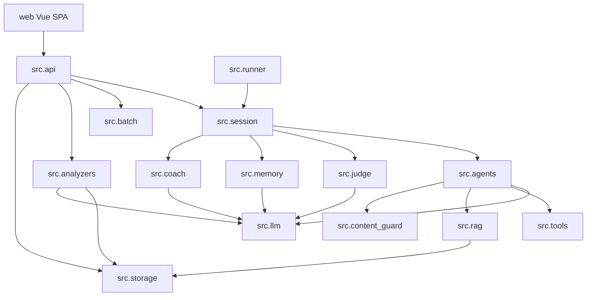

# 02 仓库地图

## 1. 仓库身份卡

| 项 | 内容 |
|---|---|
| 对外名称 | DealMind · 多人设销冠压力测试引擎 |
| 本地目录 | `F:/Langraph`（历史目录名，与框架 LangGraph **无关**） |
| GitHub | `Eddie-OS/Dealmind` |
| 架构类型 | **模块化单体**：Python FastAPI + Vue 3 SPA + SQLite + 本地 Chroma |
| 语言 | Python 3.10+（后端）、TypeScript / Vue 3（前端） |
| 包管理 | pip `requirements.txt`（无 lock）；npm + `web/package-lock.json` |
| 运行时锁定 | 未锁 Python 精确版本；前端 lock 存在 |

## 2. 顶层目录地图

| 路径 | 职责 | 分类 | 检查深度 |
|---|---|---|---|
| `src/` | 引擎、API、存储、RAG、分析 | 第一方源码 | 已重点/全文 |
| `web/` | Vue 3 管理台 | 第一方源码 | 已重点 |
| `prompts/` | Agent 提示词与阶段 YAML | 第一方配置 | 已重点 |
| `personas/` | 内置 3 个人设 YAML（CLI/种子） | 第一方配置 | 已全文 |
| `data/` | SQLite、Chroma、上传、手册种子 | 运行时数据 | 用途识别 |
| `deploy/` | Ubuntu/Caddy/systemd 部署 | 基础设施 | 已全文 |
| `scripts/` | smoke、诊断、恢复、一次性修补 | 运维/测试 | 已分类 |
| `docs/` | 产品开发主文档、分析规格、汇报稿 | 文档 | 已重点 |
| `outputs/` | 历史会话 4 件套（2431 跟踪文件） | 运行产物 | 抽样 |
| `design/` | 设计稿 | 与运行弱相关 | 识别 |
| `assets/` | 静态素材 | 与运行弱相关 | 识别 |
| `tools/` | 部署工具二进制（gitignore `*.exe`） | 第三方/本地 | 识别 |
| `logs/` `tmp/` `terminals/` | 本地日志（gitignore） | 构建/运行产物 | 排除 |
| `.codegraph/` `.cursor/` | 编辑器索引 | 与运行无关 | 排除 |
| 中文 PRD / 截图 / zip | 历史需求与训练包 | 文档/二进制 | 识别 |

根文件：`README.md`、`requirements.txt`、`.env.example`、`.gitignore`、`tmp_inspect.py`、若干中文 markdown/图片。

## 3. 语言与框架清单

| 层 | 技术 | 版本约束 | 证据 |
|---|---|---|---|
| API | FastAPI + Uvicorn | `fastapi>=0.115.0` `uvicorn[standard]>=0.30.0` | `requirements.txt:7-8` |
| 校验 | Pydantic v2 | `pydantic>=2.0.0` | `requirements.txt:4` |
| LLM | OpenAI SDK（兼容 DeepSeek） | `openai>=1.0.0` | `requirements.txt:1`；`src/llm.py` |
| RAG | Chroma + sentence-transformers | `chromadb>=0.4.0` | `requirements.txt:12-13` |
| 文档解析 | pypdf / pptx / docx / openpyxl | 见 requirements | `src/rag/parsers.py` |
| MCP | `mcp>=1.20.0` | 管理端探活，未进 Sales 循环 | `src/tools/mcp_client.py` |
| 前端 | Vue 3.5 + Vue Router 4 + Pinia 3 + Element Plus + ECharts + Vite 8 | `web/package.json` | [已证实] |
| 反向代理 | Caddy | `deploy/Caddyfile` | [已证实] |
| 进程 | systemd | `deploy/dealmind-api.service` | [已证实] |

**未使用（文档有、代码无）**：LangGraph、Redis、PostgreSQL、Docker、K8s、Prometheus。

## 4. 应用 / 服务 / 包清单

| 单元 | 入口 | 说明 |
|---|---|---|
| DealMind API | `src/api/server.py:app` | 唯一 HTTP/WS 服务 |
| Vue SPA | `web/src/main.ts` | 唯一前端 |
| CLI Runner | `python -m src.runner` | 单场会话，不经过 FastAPI |
| Session 线程池 | `session_runner_async.py` `ThreadPoolExecutor(max_workers=8)` | 进程内 |
| Batch 线程池 | `batch/runner.py` max_workers=2 + 会话并发 | 进程内 |
| Analysis 线程池 | `analyzers/analysis_runner.py` max_workers=2 | 进程内 |
| KB Indexer | `rag.seed.start_indexer_thread` | 后台守护线程 |
| Handbook 抽取 | `handbook_extractor_runner` | 后台线程 |

`src/` 逻辑包：

| 包 | 职责 |
|---|---|
| `src.api` | HTTP/WS、鉴权、会话桥接 |
| `src.agents` / `judge` / `memory` / `coach` / `session` | 多智能体核心 |
| `src.llm` / `config` / `schema` | 模型与数据模型 |
| `src.storage` | SQLite |
| `src.rag` | 解析、嵌入、向量库 |
| `src.tools` | 工具注册与实现 |
| `src.batch` | 批量编排 |
| `src.analyzers` | Handbook 分析流水线 |
| `src.persona` / `cases` / `research` | 人设、案例、市场事实 |

## 5. 关键入口

| 入口 | 符号 | 位置 |
|---|---|---|
| HTTP 应用 | `app` | `src/api/server.py:137` |
| 健康检查 | `health` | `src/api/server.py:186` |
| 会话主循环 | `run_session` | `src/session.py:234` |
| 销冠生成 | `generate_sales_turn` | `src/agents.py:1149` |
| 人设生成 | `generate_persona_turn` | `src/agents.py:1075` |
| CLI | `main` | `src/runner.py` |
| 前端路由 | `router` | `web/src/router/index.ts:168` |
| 前端实时状态 | `useLiveSessionStore` | `web/src/stores/liveSession.ts` |

## 6. 第一方文件覆盖矩阵（源码级）

> `outputs/`、向量二进制、上传原件不逐行列出。完整源码清单以 `git ls-files src web/src prompts personas deploy docs` 为准。

### 6.1 后端超大文件（修改风险最高）

| 文件 | 行数 | 检查 | 备注 |
|---|---|---|---|
| `src/storage/db.py` | 2425 | 已重点 | 几乎全部 CRUD + 迁移 |
| `src/agents.py` | 1484 | 已全文 | 双 Agent + RAG + 工具循环 |
| `src/analyzers/report_aggregator.py` | 1036 | 已重点 | 分析聚合 |
| `src/api/routes_batch_report.py` | 751 | 已重点 | 培训指南导出 |
| `src/api/routes_sessions.py` | 749 | 已重点 | 会话生命周期 |
| `src/session.py` | 526 | 已全文 | 编排核心 |
| `src/llm.py` | 524 | 已全文 | 模型调用 |
| `src/batch/runner.py` | 515 | 已重点 | 批量 |

### 6.2 前端超大文件

| 文件 | 行数 | 检查 |
|---|---|---|
| `web/src/views/scale/AnalysisReport.vue` | 2767 | 已重点 |
| `web/src/views/assets/SalesAgent.vue` | 1856 | 已重点 |
| `web/src/views/assets/HandbookManager.vue` | 1503 | 已重点 |
| `web/src/views/assets/PersonaLibrary.vue` | 1390 | 已重点 |
| `web/src/views/scale/BatchTest.vue` | 1093 | 已重点 |
| `web/src/views/system/AgentSkills.vue` | 1066 | 已重点 |
| `web/src/views/simulation/SessionDetail.vue` | 1048 | 已重点 |

其余 `src/**/*.py`（85）与 `web/src/**`（53）均已至少重点检查并纳入本分析。`scripts/` 中 15 个 `smoke_*.py` 已识别；其余 `_inspect_*` / 一次性修补归类为运维脚本。

## 7. 依赖方向（核心模块）

**依赖规则（观察，非强制分层）**：`session` 不依赖 FastAPI；`agents` 会读 SQLite（profile/skills），存在引擎对存储的隐式耦合。

## 8. README 与代码差异（以代码为准）

| README 说法 | 代码事实 |
|---|---|
| 目录 `f:\Dealmind\`，仅 CLI | 目录 `F:/Langraph`，主路径是 Web |
| v2 才做 LangGraph / Web / RAG / DB | 这些（除 LangGraph）均已实现 |
| 输出仅 4 个文件 | 另有 SQLite 实时落库 + 分析表 |
| `uvicorn --port 8000` | Vite 代理与 systemd 使用 **8001**（`web/vite.config.ts:17`，`deploy/dealmind-api.service:10`） |
| 人设只有 3 个 YAML | DB 中约 94 个人设 |
| 产品是“智学 Pro 学习平板” | 现网数据以华为平板 Handbook 等为主 |

差异单列，避免把文档当事实。
