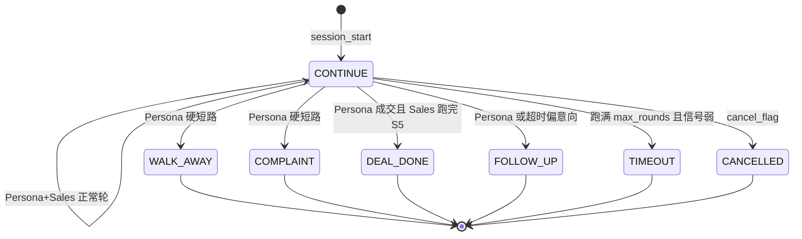

# 03 业务与领域模型

## 1. 项目目标

用可编程的高压力客户人设，对销冠 Agent 进行多轮销售博弈，在会中由 Judge 控节奏、Memory 记画像，会后由 Coach 复盘，并把对话沉淀为案例、优秀话术、批量培训指南和 Handbook 分析报告。

**目标用户（从页面与角色模型还原，非独立账户系统）**

| 角色 | 实际实现 | 典型目标 |
|---|---|---|
| 销售培训负责人 / 门店教练 | 唯一登录用户 `admin` | 跑压测、看报告、导出培训材料 |
| Prompt / Agent 调优者 | 同一账号 | 改销冠 Prompt、工具、模型 |
| 知识管理员 | 同一账号 | 上传产品/企业资料、维护 Handbook |
| 系统运维 | 同一账号 | 看运行状态、日志、向量库 |

**没有**学员账号、没有门店多租户、没有 RBAC。UI 硬编码显示 `admin`（`web/src/layouts/AppShell.vue`）。

## 2. 核心能力 vs 辅助能力

### 已实现核心能力

| 能力 | 页面 | API | 服务 | Agent | 表 | 测试 |
|---|---|---|---|---|---|---|
| 单场压力测试 | NewSession + LiveSession | `POST /api/sessions` + `/start` + WS | `SessionRunner` → `run_session` | Persona/Sales/Judge/Memory/Coach | sessions/turns/evaluations | 无自动化；CLI `--one-turn-test` |
| 会话复盘 | SessionDetail / History | `/detail` `/export` | REST 聚合 | Coach 结果只读 | 同上 | 无 |
| 批量压测 | BatchTest | `POST /api/batch` + WS | `BatchRunner` | 同上 | batch_jobs + sessions | 无 |
| 批量培训报告 | BatchReport | `/api/batch/{id}/report/*` | SQL 聚合 | 读 Judge/Memory | sessions/evaluations | 无 |
| Handbook 分析 | AnalysisReport | `/api/analysis/jobs` | `AnalysisRunner` | 分析用辅助 LLM | analysis_* / excellent_phrases | smoke_test_analysis_* |
| 人设库 | PersonaLibrary | `/api/personas` | LLM 生成/抽压 | Pressure Extractor | personas | smoke_persona_prompt_render |
| 产品/企业 KB | ProductKB / EnterpriseKB | `/api/kbs` | indexer + Chroma | Sales RAG 工具 | knowledge_* | 无 |
| 产品手册 | HandbookManager | `/api/handbooks` | 抽取线程 | Handbook Extractor | product_handbooks | smoke_test_handbook_* |
| 案例 / 话术 | SalesCases / ExcellentPhrases | `/api/cases` `/excellent-phrases` | 会话收藏 + 分析沉淀 | 无对话 Agent | sales_cases / excellent_phrases | 无 |
| 销冠配置 | SalesAgent | `/api/agent-profile` | 版本快照 | Sales Prompt | agent_profiles | 无 |
| 工具开关 | AgentSkills | `/api/agent-skills` | registry | Sales tools | agent_skills_config | _smoke_tool_loop（脚本） |
| 模型供应商 | ModelSettings | `/api/providers` | llm client | 全部 Agent | llm_providers | 未跑 --test-llm |
| Dashboard | HomeView | `/api/dashboard/*` | SQL | 无 | sessions/evaluations | 无 |

### 部分实现 / 占位

| 能力 | 状态 | 证据 |
|---|---|---|
| MCP 作为销冠工具 | 客户端 + 管理 API 就绪，**未注册进 Sales `enabled_tools`** | `src/tools/__init__.py:29-32` 只 import rag/web/sales_ops |
| experience KB collection | Chroma 名预留 | `src/rag/kb_store.py:28-32` |
| LangGraph 可视化编排 | 仅 README 蓝图 | 全 `src/` 无 langgraph |
| 多用户 / 权限 | 未做 | `auth.py` 单管理员 |
| Token 级流式输出 | 未做 | `llm.py` 完整响应；WS 是轮次事件 |
| 人工审批单轮话术 | 未做 | 仅 pause/cancel |
| 自动化 CI / pytest | 文档提到“可选”，未落地 | 0 个 test_*.py |

### 已废弃 / 文档残留

- `web/src/views/placeholder/PlaceholderView.vue`：Stage 0 占位，路由未挂。
- README「智学 Pro」产品叙事 vs 代码/数据中的华为平板 Handbook。
- `STAGES` 6 段中文数组仍在 `session.py:46-53`，真实推进已是 YAML 的 S1–S5。

## 3. 核心用户旅程

### 旅程 A：单场对练（最重要）

1. 登录 → Dashboard。
2. 新建对话：选 Persona、产品/企业 KB、Handbook、轮次/间隔。
3. `create` + `start` → 跳转 Live。
4. WS 收看 Persona/Sales 交替、阶段线、Judge 卡、右栏 RAG/画像。
5. 可暂停 / 取消；结束后看 Coach，进复盘页，可收藏案例。

前置：至少一个 Persona、可选 KB/Handbook、可用 LLM Provider。  
异常：并发满 → 429；LLM 失败 → fallback turn；WS 断线 → 会话继续跑。

### 旅程 B：批量压测出培训材料

1. 批量测试页多选人设，设并发与轮次。
2. 创建 batch → 进度抽屉（**注意 WS 缺 token，生产可能连不上**）。
3. 完成后看 BatchReport：异议、雷达、RAG/剧本统计，导出 Training Guide。

### 旅程 C：手册驱动分析

1. 上传 Handbook 源文件 → 抽取结构。
2. 对某场会话或某个 batch 建 analysis job。
3. 逐 turn 分类打分 → persona 洞察 → 优秀话术入库。

## 4. 领域实体与术语

| 术语 | 含义 | 代码载体 |
|---|---|---|
| Persona | 虚拟客户人设（结构化或 prompt_based） | `personas` 表；`PersonaProfile` |
| PressureProfile | 9 维压力（价格敏感、怀疑等 0–1） | `pressure_json` |
| Sales / 销冠 | 被测销售 Agent | `agent_profiles.sales` |
| Handbook | 产品话术/演示剧本结构化手册 | `product_handbooks.structure_json` |
| Playbook action | 销冠本轮宣称执行的手册动作 | `SalesStrategy.playbook_action` |
| Stage S1–S5 | 销售路径阶段 | `prompts/business_stages.yaml` |
| Phase | mining/matching/pressure/closing 软约束 | `agents._phase_from_state` |
| Judge | 会中导演：评分+转阶段+双方指令 | `JudgeFeedback` |
| Session Memory | 会中客户画像 | `SessionMemory` |
| Coach | 会后复盘 | `CoachReview` |
| HiddenState | 客户不可见意图/成交信号 | `schema.HiddenState` |
| outcome | CONTINUE / DEAL_DONE / WALK_AWAY / FOLLOW_UP / COMPLAINT / TIMEOUT / CANCELLED | `DialogueState` |
| Fact card | 会前产品事实卡 | `preflight.build_product_fact_card` |
| content_guard | 无证据数字改写 | `verify_and_rewrite` |

## 5. 状态机

### 5.1 会话 status（DB）

pending → running → completed | cancelled | error（由 API/Runner 更新）。

### 5.2 对话 outcome（引擎）

护栏：`max_rounds_floor` 之前忽略一切 terminal（`src/session.py:196-200,549-555`）。

### 5.3 销售阶段 S1–S5

合法转移：原地、前进一格、或显式回退 S3→S2 / S4→S3（`business_stages.is_valid_transition`）。  
推进者是 Judge，不是轮次硬切。`stage_quota` 只提供理想窗口给 Judge 看。

## 6. 输入 / 输出 / 成功标准

**输入**：人设、产品资料/KB/Handbook、主题、轮次、模型、工具开关。  
**输出**：对话、Judge/Coach、4 个 `outputs/{id}/` 文件、DB 行、批量 Training Guide、分析 HTML/MD。  
**仓库内 SLA 目标**（`.env.example`，未在代码强制）：44 场批量 ≤2h；745 turn 分析 ≤2h。  
**业务 KPI（Dashboard 已算）**：场次、成交/流失分布、人设难度、趋势。

## 7. 端到端追踪矩阵（浓缩）

见上表「已实现核心能力」。闭环情况：

- 页面均有对应 API（除 Placeholder）。
- `GET /api/personas/meta/dimensions` **后端有、前端未用**。
- experience KB 前端无独立页。
- MCP 有管理 UI，无销售运行时闭环。
