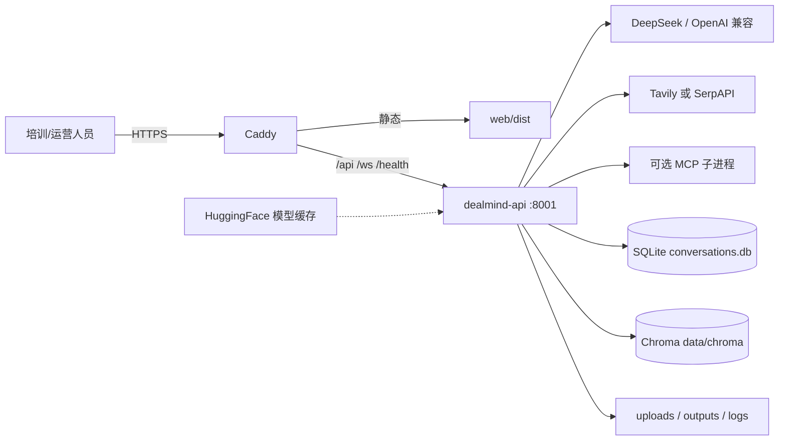
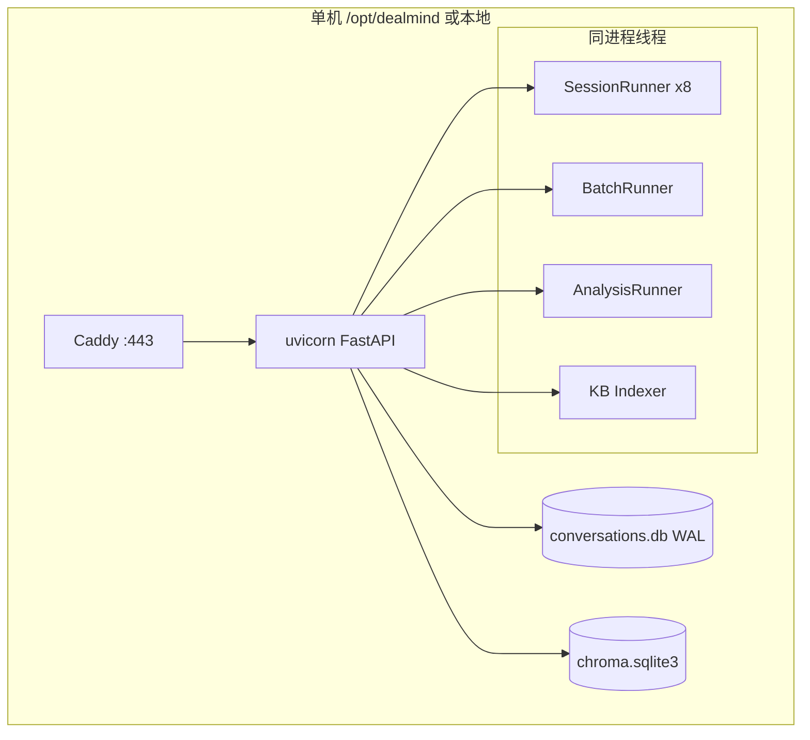
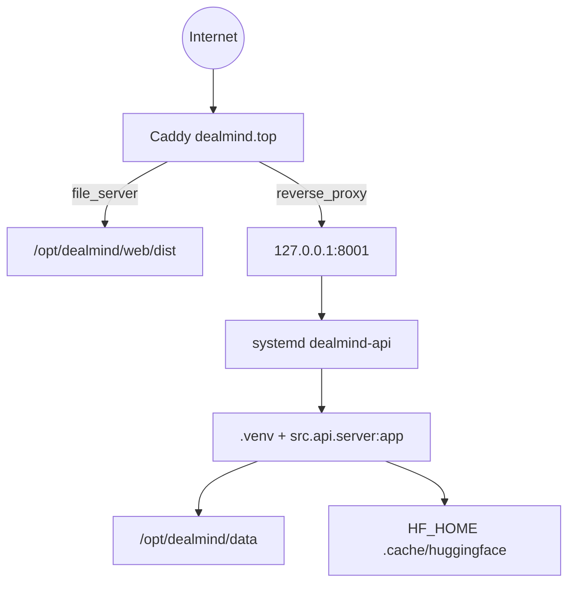
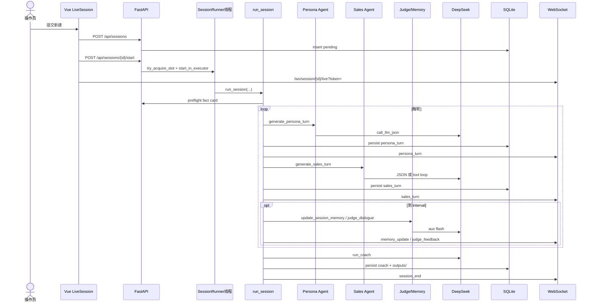

# 04 系统架构

## 1. 系统上下文

**证据**：`deploy/Caddyfile:13-36`；`src/llm.py`；`src/tools/web_search.py`；`src/tools/mcp_client.py`；`src/storage/db.py:25`；`src/rag/kb_store.py:26`。

外部系统边：

| 外部 | 用途 | 是否必须 | 证据 |
|---|---|---|---|
| DeepSeek 兼容 API | 全部 Agent | 是 | `OPENAI_BASE_URL` / `llm_providers` |
| HuggingFace | bge-small-zh-v1.5 | RAG 需要 | `embedder.py:25` |
| Tavily/SerpAPI | web_search | 可选 | `web_search.py` |
| MCP Server | 管理端探活 | 可选，未进 Sales | `mcp_client.py` |
| Let's Encrypt | 生产证书 | 生产 Caddy | `Caddyfile` |

虚线 / 待验证：是否还有其他 LLM 供应商在生产库中（本机未读 `.env`）。

## 2. 容器 / 服务图

**不是**独立 worker 服务。扩容方式是垂直加内存/调并发环境变量，不是水平拆服务。

## 3. 核心模块依赖

见 `02_REPOSITORY_ATLAS.md` §7。额外耦合：

| 耦合 | 说明 | 风险 |
|---|---|---|
| `agents.py` → SQLite `agent_profiles` / `agent_skills_config` | 引擎层读库 | CLI 与 API 共享隐式全局 |
| `llm.py` → DB default provider | 热切换模型 | 测试需真实 DB |
| `session` → 文件系统 `outputs/` | 与 DB 双写 | 可能不一致 |
| persist 失败吞掉 | WS 有、DB 无 | 复盘丢轮次 |

## 4. 部署拓扑

证据：`deploy/dealmind-api.service:9-14`；`deploy/Caddyfile`；`deploy/setup.sh`。  
本机开发：Vite `:5173` 反代 `8001`（`web/vite.config.ts:12-28`）。`server.py` 注释仍写 8000，**以 8001 为准**。

可选 `deploy/harden.sh`：cgroup MemoryMax=1400M（2G 机器）。

## 5. 一次核心请求时序（单场对练）

证据：`routes_sessions.py` start；`session_runner_async.py:157-271`；`session.py:234+`；`session_persistence.py:25-76`；`ws_session.py`。

## 6. Composition Root 与生命周期

- FastAPI `lifespan`（`server.py:79-134`）：logging → schema → 种子 → indexer → 预加载 embedder。
- 配置：先 `load_dotenv` 再 import 业务（`server.py:29-43`），否则 embedder 维度错导致 RAG 0 命中。
- 无 DI 容器；模块级单例（OpenAI client、embedder、工具 registry）。
- 关闭：只打日志，**无优雅排空**正在跑的 session/batch。

## 7. 同步 / 异步 / 事件

| 模式 | 用途 |
|---|---|
| 同步 HTTP | 几乎全部 REST |
| 线程池 + asyncio.Queue | 会话/批量事件桥到 WS |
| 后台线程 | KB 索引、Handbook 抽取、Analysis |
| 定时 | 前端 health 10s；**无 cron** |
| Webhook | 未发现 |

## 8. 单点与边界泄漏

- **SPOF**：单进程 API + 单 SQLite + 单 Chroma 目录。
- **隐式全局**：`_active_runners`、LLM semaphore、embedder 单例。
- **循环依赖**：未发现硬循环；`agents`↔`storage` 是向下泄漏。
- **进程重启**：内存中的 running session 丢失；DB 可能停在 running（batch 有 resume，单场无 checkpoint 续跑）。
