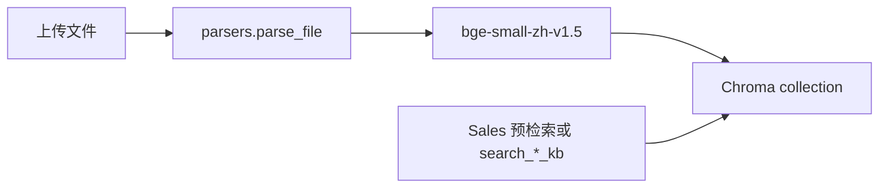

# 06 模型、Prompt、工具与 RAG

## 1. 模型供应商与路由

优先级（`src/llm.py:260-307` `_get_client_and_settings`）：

1. `with_llm_override(provider_id=...)`
2. SQLite `llm_providers` 默认行
3. `.env` `load_settings()`

| Agent | 模型 | 参数 | 证据 |
|---|---|---|---|
| Sales | default 或 DB override；建议 pro | thinking disabled；temp 0.6 | `agents.py:1164-1168,1299` |
| Persona / Opening | default | thinking disabled；Persona temp 0.8 | `1125-1127` |
| Judge / Memory / Coach / 分析 | `AUX_MODEL_NAME` 默认 `deepseek-v4-flash` | temp 0.2/0.3 | `perf_config.py:29-34` |
| Provider test | 请求体指定 | ping | `routes_providers.py:192-238` |

Fallback：重试、JSON 再解析、`response_format` 降级、thinking 不支持则剥 extra_body、代理失败改直连、embedder 失败用 Chroma 默认（`llm.py` / `embedder.py:86-92`）。

供应商切换：**可用**（DB 改 default）。隐式绑定：Sales 关闭 thinking 是为 DeepSeek V4-Pro + function calling。

---

## 2. Prompt 全量清单

| ID | 文件/位置 | 使用者 | 变量（主要） | 版本控制 |
|---|---|---|---|---|
| P-SALES | `prompts/sales_prompt.md` | Sales | handbook/fact/market/RAG/history/stage/tool_status… | **DB 可覆盖** |
| P-PER | `prompts/persona_prompt.md` | Persona structured | profile/pressure/instruction/memory/stage | 文件 |
| P-PER2 | `prompts/persona_prompt_v2.md` | Persona prompt_based | prompt_text + 同上 | 文件 |
| P-JUDGE | `prompts/judge_prompt.md` | Judge | stages/quota/playbook/history | 文件 |
| P-COACH | `prompts/coach_prompt.md` | Coach | playbook_stats/history | 文件 |
| P-MEM | `prompts/session_memory_prompt.md` | Memory | old_memory/history | 文件 |
| P-PRESS | `prompts/pressure_extractor_prompt.md` | 抽压力维 | persona_prompt | 文件 |
| P-STAGES | `prompts/business_stages.yaml` | 多处渲染 | 结构化，非 `{var}` | 文件热加载 |
| P-SYS-* | `agents.py`/`judge.py`/`memory.py`/`coach.py` 硬编码 system | 各 Agent | 语言指令 | 无版本 |

渲染：`render_prompt` 简单 `{key}` 替换（`agents.py:949-957`）。**无** Prompt 校验器、无 A/B、无变更审计（销冠除外：`agent_profile_versions`）。

---

## 3. 用户输入 → 模型请求：上下文组装

| 片段 | 来源 | 谁写入 | 可信度 | 预算 |
|---|---|---|---|---|
| System 前缀 | 代码常量 | 开发者 | 高 | 短 |
| 语言指令 | `state.language` / locales | 会话配置 | 高 | 短 |
| Handbook 块 | `product_handbooks` | 知识管理员 | 中高（可能过时） | 截断策略在 handbook builder |
| Product fact card | preflight（KB+搜索+LLM） | 系统 | 中（失败则 UNCERTAIN） | 会前一次 |
| Market facts | `market_facts` | 研究模块 | 中 | 中 |
| Brand block | `brand_profiles` | 种子/管理员 | 高 | 短 |
| product_hits / enterprise_hits | Chroma | 检索 | 中（embedding 错则 0） | chunk 600 字，top 3+2 |
| tool_status / tool results | 工具 | 模型触发 | 低–中（可注入） | 结果 3000 字 |
| session_memory | Memory Agent | LLM 提取 | 中 | 中 |
| sales/persona_instruction | Judge | LLM | 中 | 短 |
| recent_history | 前轮 Turn | Agent | 中（含模型输出） | 最多 10 条 |
| persona prompt_text | 用户上传/生成 | 人设管理员 | **低（注入面）** | 可很长 |
| Sales system_prompt | DB 在线编辑 | 调优者 | 高权限 | 可很长 |

Streaming：无 token 流。前端消费轮次 JSON 事件。

Token 统计：`_log_usage` 打控制台，**不落库**（`llm.py:344-364`）。无 Batch/日费用面板。

---

## 4. Tool / MCP 全量清单

注册副作用：`src/tools/__init__.py:29-32`。

| name | 定义 | 类别 | 能力边界 | 调用者 | 确认？ |
|---|---|---|---|---|---|
| `search_product_kb` | `rag_search.py:76` | rag | 指定产品 KB 向量检索 | Sales（若启用） | 否，模型可直接调 |
| `search_enterprise_kb` | `rag_search.py:109` | rag | 企业 KB | Sales | 否 |
| `search_sales_cases` | `rag_search.py:141` | rag | SQLite LIKE 案例 | Sales | 否 |
| `search_excellent_phrases` | `rag_search.py:199` | rag | 话术库 | Sales | 否 |
| `web_search` | `web_search.py:269` | web | Tavily/SerpAPI；销冠路径锁 `include_domains` | Sales | 否 |
| `quote_calculator` | `sales_ops.py:86` | calc | 折抵/分期（计算） | Sales | 否 |
| `inventory_check` | `sales_ops.py:190` | ops | **示意库存** | Sales | 否 |
| `promotion_lookup` | `sales_ops.py:237` | ops | **示意促销** | Sales | 否 |
| `spec_compare` | `sales_ops.py:302` | calc | 参数差值 | Sales | 否 |

调度：`run_tool_safe`（`registry.py:155-170`）吞异常。  
循环：`max_tool_loops` 默认 3，硬顶 8（`agents.py:1423-1424,1525-1526`）。

**MCP**

| 能力 | 状态 |
|---|---|
| stdio 客户端 | `mcp_client.py`，超时 12s |
| 管理 API | `POST /api/agent-skills/mcp/probe`、`/mcp/call_tool` |
| Sales 运行时 | **未接入 registry** |
| 风险 | probe/call 接受任意 `command/args/env`，合并 `os.environ` |

工具结果回填模型 → 存在间接 Prompt Injection（网页/KB 内容）。无专门检测。

高风险：管理端 `test_tool` / MCP 不需要第二人确认，只需要登录。

---

## 5. RAG 与知识系统



| 环节 | 实现 |
|---|---|
| 数据源 | 管理员上传 txt/md/pdf/docx/pptx/xlsx |
| 权限继承 | 按 kb_id / kb_type，无文档级 ACL |
| Embedding | 默认 `BAAI/bge-small-zh-v1.5`；失败 Chroma default（**维度可能漂**） |
| 索引 | `data/chroma/`，cosine |
| 集合 | `product_knowledge` / `enterprise_knowledge` /（预留 experience） |
| 在线检索 | `_build_rag_query` + 中英关键词增强（`agents.py:292-367`） |
| top_k | 产品 3 + 企业 2 |
| 重排 | 未发现独立 rerank |
| 引用回链 | 前端展示 filename/section（LiveInsightsPanel）；非严格引用约束生成 |
| 删除同步 | 删文件 API 会清 chunks |
| 重建 | VectorAdmin rebuild/clear（破坏性，无二次确认） |

离线：`start_indexer_thread` 消费 pending。  
幻觉控制：主要靠 content_guard + handbook 证据，不是 RAG citation 强制。

---

## 6. Structured Output

- `call_llm_json` + Pydantic 模型。
- 失败再拼一轮“只输出 JSON”。
- 工具路径最后强制 JSON。
- 无 schema 自动修复库（如 json-repair），靠 fallback turn。

---

## 7. 信任边界

```
管理员 Prompt / KB / Persona 文本
        ↓  默认信任
   模型上下文
        ↓  半信任
   工具（web/KB）结果
        ↓  低信任，无消毒
   销冠可见话术
        ↓  content_guard（仅数字/型号）
   前端展示 / 落库
```

Human-in-the-loop **不**拦截单轮输出。content_guard 防编造参数，不防越狱。
