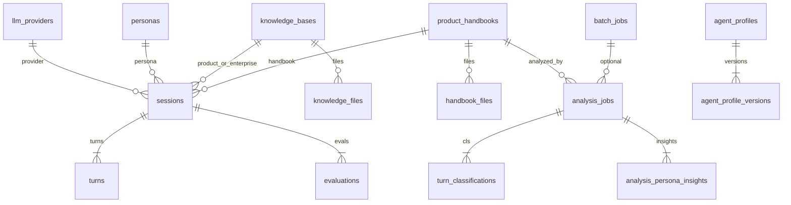

# 09 数据库与数据生命周期

## 1. 引擎与连接

- 类型：SQLite 单文件 `data/conversations.db`（`src/storage/db.py:25`）。
- 连接：每调用新连接，`check_same_thread=False`（`33-46`）。
- PRAGMA：`foreign_keys=ON`，`WAL`，`busy_timeout=5000`，`synchronous=NORMAL`（`48-57`）。
- 事务：`connection_scope` commit/rollback（`61-72`）。
- 无读写分离、无连接池产品（SQLite 不需要经典池）。
- 多环境：靠不同机器上的 `data/` 目录，无 DATABASE_URL 抽象。

向量库：`chromadb.PersistentClient` → `data/chroma/`（`kb_store.py:26,70-73`）。

## 2. ER 图

声明表：`ALL_SCHEMAS` `src/storage/models.py:416-438`（20 张）。  
运行时另建：`session_runtime_persona`（`analyzers/runtime_persona.py:39-51`）。

## 3. 数据字典（关键字段）

| 表 | 关键字段 | 备注 |
|---|---|---|
| llm_providers | name, base_url, **api_key**, model_name, is_default | key 明文 |
| personas | format_type, profile_json, pressure_json, prompt_text, country_code | PII 型画像 |
| knowledge_bases | kb_type, file_count, chunk_count | product/enterprise/experience |
| knowledge_files | file_path, status, chunk_count | pending→indexed |
| sessions | id TEXT, config_json, summary_json, status, handbook_id | 会话主表 |
| turns | idx, role, content, metadata_json | UNIQUE(session,idx,role) |
| evaluations | evaluator_role, score_json, feedback_json | judge/coach |
| batch_jobs | persona_ids_json, session_ids_json, status | |
| sales_cases | source, dialogue_excerpt_json | |
| excellent_phrases | sales_content, excellence_score | UNIQUE(session,turn,label) |
| agent_profiles | system_prompt, opening_lines_json, model_override | |
| agent_profile_versions | snapshot_json | |
| agent_skills_config | id=1, enabled_tools_json, web_search_api_key, mcp_servers_json | |
| product_handbooks | structure_json, status, version_no | |
| handbook_files | parsed_text | ≤500KB 级 |
| analysis_jobs | progress, summary_json | batch XOR session |
| turn_classifications | category_id, scores_json | |
| analysis_persona_insights | top_concerns_json | |
| market_facts | country_code, facts_json | |
| brand_profiles | identity_block | 华为默认种子 |

索引：`SCHEMA_INDEXES` `models.py:441+`（session/turns/evaluations/cases/batch 等）。  
无视图/触发器/存储过程。

## 4. ORM vs Schema

无 SQLAlchemy 模型层。Schema 是 SQL 字符串 + `db.py` 手写 SQL。一致性靠 `init_schema` + 增量 `ALTER`（如 personas 市场字段 `db.py:198-227`，sessions.handbook_id `146-173`）。

有数据时拒绝某些 DROP（`db.py:90-97,186-192`）——[已证实] 保护意识存在。

## 5. 迁移时间线（代码内嵌，无 alembic）

1. CREATE IF NOT EXISTS 全表。
2. 空 sales_cases 旧列则重建。
3. handbook / personas / brand seed。
4. `migrate_env_to_db`：providers 空且 .env 有 key → 插入 default（`migrations.py:35-72`）。
5. 种子：personas、KB、preset cases。

**不可逆**：无 down migration。漂移靠启动时探测列。

Seed/Fixture：`persona.seed`、`rag.seed`、`cases.seed`、`data/product_handbooks/*.json`。测试数据即 `outputs/` 与当前 DB 快照（commit `e10f247` 纳入历史数据）。

## 6. 写入 / 读取链路

**会话写**：`on_event` → `persist_event` 仅 6 类：persona/sales/judge/coach/memory（`session_persistence.py:8-11,25-73`）。`session_end` 只推 WS。失败吞掉。

**双写**：同时 `write_session_outputs` 到 `outputs/{session_id}/`（`session.py` 结束后）。[待验证] 与 DB 是否始终一致。

**KB 写**：upload → pending → indexer parse/embed → Chroma + status indexed。

**分析写**：classifications → insights → excellent_phrases。

**读**：REST 列表详情；Dashboard SQL；Sales RAG query；Batch report 聚合。

## 7. 生命周期与删除

| 数据 | 创建 | 删除 | 归档 | 保留策略 |
|---|---|---|---|---|
| session/turns/eval | 运行时 | DELETE session 级联 + 删 outputs | 无 | 无 TTL |
| batch_jobs | 创建任务 | 删 job 行，**保留 sessions** | 无 | 无 |
| KB 文件 | 上传 | API 删文件+向量 | 无 | 无 |
| handbook | 创建/抽取 | 级联删文件 | 无 | 无 |
| providers keys | UI | DELETE | 无 | 明文 |
| 备份 | 手工 gz | — | `conversations.db.gz` | 无自动 |

软删除：未发现。审计：`created_at/updated_at` 部分表有。租户字段：无。版本：handbook.version_no、agent_profile_versions。

## 8. 查询风险

- N+1：报告聚合在 Python 层拼 JSON，大 batch 可能慢（`routes_batch_report.py` 751 行）。
- 大字段：`turns.content`、`handbook_files.parsed_text`、`structure_json`。
- 无限分页：需核对各 list 默认 limit（sessions 路由有分页参数）。
- SQLite 锁：WAL + timeout，高并发分析+会话仍可能 busy。
- Chroma 与 SQL 计数可能短暂不一致（indexer 异步）。

## 9. 当前体量（分析时本机文件，不 dump 内容）

来自只读计数（探索代理）：sessions≈616，turns≈22118，evaluations≈2604，personas≈94，batch_jobs≈27，sales_cases≈1305，excellent_phrases≈186，analysis_jobs≈40，handbooks≈5。  
Chroma：product≈228，enterprise≈3207 embeddings。

**PII**：对话全文、人设、案例；密钥在表内。见 `11`。
