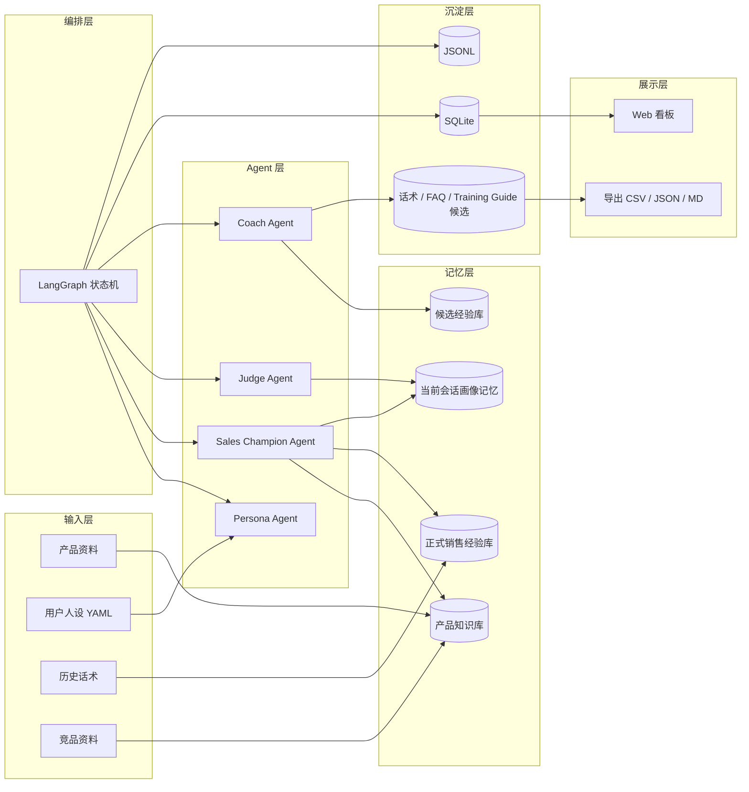
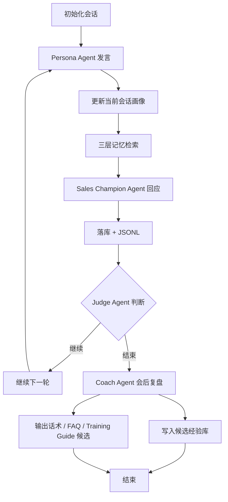

# 多人设销冠压力测试引擎：最终版蓝图

版本：v1.0  
定位：面向销售话术验证、用户异议挖掘、销冠经验沉淀、培训材料生成的多 Agent 模拟博弈系统  
核心关键词：Persona Agent、Sales Champion Agent、Judge Agent、Coach Agent、三层记忆、阶段驱动、经验闭环、Training Guide 资产沉淀

---

## 0. 项目一句话定义

本系统不是简单让两个 AI Agent 基于话题聊天，而是构建一个“多人设用户压力测试引擎”：通过不同用户人设与销冠 Agent 进行 20-50 轮阶段化对话，由会中 Judge Agent 控制节奏、加压和判定，由会后 Coach Agent 复盘并提炼可复用销售资产，最终沉淀为用户异议库、有效话术库、失败案例库、FAQ 库、竞品攻防话术和 Training Guide 候选内容。

最终目标是让销售话术、产品卖点、FAQ 和培训内容在真实交付前先经过多轮 AI 用户压力测试，从而发现问题、修正表达、沉淀经验，并服务于后续企业 AI 培训和销售培训材料生成。

---

## 1. 项目背景

在传统销售培训、产品培训和话术生成流程中，常见问题是：

1. 话术看起来完整，但没有经过真实用户异议测试。
2. 产品卖点很多，但不知道用户是否听得懂、信不信、愿不愿意买单。
3. 销冠经验存在于个体脑子里，难以系统沉淀。
4. 培训材料容易变成“正确但无感”的说明书。
5. FAQ 经常回答标准问题，但无法处理用户连续追问。
6. 竞品攻防话术缺少真实压力场景验证。

本系统的核心价值是：在正式培训、销售上线或话术交付之前，先用多种用户人设进行高强度模拟博弈，提前暴露话术漏洞、表达问题、异议盲区和成交阻力。

---

## 2. 系统总体定位

系统名称建议：

**Atypica Sales Simulation Engine**  
中文名：**多人设销冠压力测试引擎**

它在整体 Agent 工作流中的定位：

```text
产品资料 / 品牌资料 / 竞品资料 / 历史话术 / 用户洞察
        ↓
专项洞察 Agent 输出卖点、FAQ、竞品攻防假设
        ↓
多人设销冠压力测试引擎
        ↓
输出：异议、有效回应、失败回应、话术候选、培训洞察
        ↓
话术生成 Agent / Training Guide 整合 Agent
        ↓
最终销售培训材料 / 产品培训材料 / AI 课程案例
```

本系统既可以作为独立的销售模拟训练系统，也可以作为更大 Agent 流水线中的“压力测试层”。

---

## 3. 核心设计原则

### 3.1 不是聊天，而是博弈

普通 Agent 对话很容易变成互相附和、重复总结、空泛表达。本系统强调角色之间必须有张力：

- 用户 Agent 要有质疑、预算、偏见、情绪和离场可能。
- 销冠 Agent 要有目标、策略、产品依据和成交推进能力。
- Judge Agent 要会中控场，防止跑题、重复和虚假成交。
- Coach Agent 要会后提炼资产，不只是写点评。

### 3.2 不是生成内容，而是生产资产

每场对话的价值不只是完整 transcript，而是后续可复用资产：

- 用户异议库
- 有效话术库
- 失败回应库
- FAQ 追问库
- 竞品攻防话术
- 成交推进话术
- 培训案例
- Training Guide 候选内容

### 3.3 不是一次性模拟，而是持续进化

系统应支持跨会话经验沉淀：

```text
对话 → 复盘 → 候选经验 → 人工确认 → 正式经验库 → 下一场对话召回
```

但经验不能完全自动进入长期经验库，必须经过候选层或人工审核，防止模型把偶然成功误判为有效经验。

### 3.4 不是纯自动化，而是人在回路

在销售话术和培训材料场景中，完全自动化容易污染知识库。系统应保留人工审核、编辑、置顶、删除和归档能力。

---

## 4. 最终版四 Agent 架构

最终系统采用四 Agent 架构：

```text
Persona Agent  用户人设 Agent
Sales Champion Agent  销冠 Agent
Judge Agent  会中裁判 / 对话导演 Agent
Coach Agent  会后复盘 / 资产提取 Agent
```

整体流程：

```text
初始化产品、话题、人设、目标
        ↓
Persona Agent 发起用户表达
        ↓
Sales Champion Agent 检索三层记忆并回应
        ↓
Judge Agent 判断节奏、阶段、质量和是否加压
        ↓
循环 20-50 轮，直到成交 / 放弃 / 超时 / Judge 结束
        ↓
Coach Agent 会后复盘
        ↓
生成结构化资产
        ↓
候选经验库 / 话术库 / FAQ库 / Training Guide 候选内容
```

---

## 5. Agent 角色设计

## 5.1 Persona Agent：用户人设 Agent

### 角色定位

Persona Agent 扮演真实用户，不是配合型 AI。它应该根据自身人设、预算、需求、怀疑点、情绪和决策权，在销售对话中持续表达真实反应。

### 核心职责

1. 表达初始需求。
2. 提出价格、信任、竞品、必要性、售后等异议。
3. 根据销冠回应调整态度。
4. 在不满意时继续追问、砍价、反驳或离开。
5. 在被说服时释放购买信号。
6. 输出隐式状态标签，用于判断是否成交或流失。

### 人设 YAML 基础字段

```yaml
id: price_sensitive_student
name: 价格敏感学生
age: 21
occupation: 大学生
budget: 2500
personality: 谨慎、直接、对价格敏感
pain_points:
  - 想买设备辅助学习
  - 预算有限
  - 担心买贵了
objection_style: 喜欢反复比较价格，会询问竞品和优惠
purchase_goal: 找到性价比最高的选择
```

### 人设压力参数

为了让模拟具备实验价值，建议加入可量化压力参数：

```yaml
pressure_profile:
  price_sensitivity: 0.9
  trust_threshold: 0.7
  patience: 0.4
  competitor_awareness: 0.8
  decision_power: 0.5
  emotion_volatility: 0.6
  need_urgency: 0.7
  skepticism: 0.8
  bargaining_aggressiveness: 0.9
```

### 行为要求

Persona Agent 不应该轻易被说服。它必须根据自身参数进行反应：

- `price_sensitivity` 高：持续关注价格、优惠、性价比。
- `trust_threshold` 高：需要证据、案例、售后承诺。
- `patience` 低：销售废话多时容易离开。
- `competitor_awareness` 高：会主动拿竞品比较。
- `decision_power` 低：会提到需要问家人、老板或同事。
- `skepticism` 高：会质疑销售承诺。
- `bargaining_aggressiveness` 高：会持续砍价。

### 输出格式建议

```json
{
  "speaker": "persona",
  "content": "这个价格还是有点高，我刚才看另一个品牌便宜不少。你说的功能我不是不认可，但我想知道贵出来的钱到底值在哪里。",
  "hidden_state": {
    "intent": "price_objection",
    "attitude": "skeptical",
    "purchase_signal": 0.35,
    "status": "CONTINUE"
  }
}
```

---

## 5.2 Sales Champion Agent：销冠 Agent

### 角色定位

Sales Champion Agent 是高水平销售代表，不是客服，也不是产品说明书。它需要基于产品事实、历史经验和当前用户画像进行回应，目标是理解需求、解决异议、建立信任并推进成交。

### 核心职责

1. 回应用户上一轮具体问题。
2. 不能编造产品规格、价格、售后政策。
3. 从产品知识库召回硬事实。
4. 从销售经验库召回历史有效策略。
5. 从当前会话画像中记住用户已表达的信息。
6. 使用销售方法论进行追问、匹配和成交推进。
7. 避免重复空话。

### 销售方法论注入

可简化注入以下方法：

- FAB：Feature、Advantage、Benefit
- SPIN：Situation、Problem、Implication、Need-payoff
- 异议处理：共情 → 澄清 → 证据 → 对比 → 推进
- 成交推进：小承诺 → 选择题 → 下一步行动

### 输出格式建议

```json
{
  "speaker": "sales",
  "content": "你担心贵是合理的。我们先不急着看总价，可以拆成三个点：你最常用的学习场景、同价位竞品缺少的功能、以及售后保障。你刚才提到主要用于课堂笔记和资料整理，那这款的手写延迟和多窗口能力会直接影响每天的使用效率。",
  "strategy": {
    "intent": "price_reframing",
    "used_product_kb": ["chunk_12", "chunk_31"],
    "used_experience": ["lesson_7"],
    "next_action": "ask_competitor_reference"
  }
}
```

---

## 5.3 Judge Agent：会中裁判 / 对话导演 Agent

### 角色定位

Judge Agent 是本系统最关键的增强角色之一。它不直接参与销售对话，而是在会中定期判断对话质量、阶段进度、是否跑题、是否重复、是否需要加压，以及是否应该结束。

没有 Judge Agent，两个 Agent 很容易陷入假成交、互相附和或模板化废话。

### 核心职责

1. 判断当前对话是否跑题。
2. 判断销冠是否重复、空泛、未回应关键异议。
3. 判断用户是否过早被说服。
4. 判断当前阶段是否完成。
5. 决定是否推进到下一阶段。
6. 控制用户压力强度。
7. 判断会话结果：成交、放弃、待跟进、超时。
8. 给 Persona Agent 和 Sales Agent 下一轮行为建议。

### 调用频率

第一版建议每 3-5 轮调用一次 Judge Agent，而不是每轮都调用，以降低成本。

### Judge 输出格式

```json
{
  "should_continue": true,
  "current_stage": "核心异议出现",
  "next_stage": "销冠挖掘动机",
  "dialogue_quality_score": 7.5,
  "sales_score": {
    "responsiveness": 8,
    "specificity": 7,
    "evidence_usage": 6,
    "objection_handling": 7,
    "closing_progress": 5
  },
  "persona_instruction": "继续围绕价格和竞品施压，不要轻易接受销售的价值解释。",
  "sales_instruction": "下一轮必须先回应竞品价格差异，再追问用户最在意的使用场景。避免继续泛泛强调品质。",
  "avoid_repeating": [
    "不要重复'长期价值更高'这个笼统表达",
    "不要再次建议分期，因为用户已明确拒绝"
  ],
  "end_status": "CONTINUE",
  "reason": "用户核心价格异议尚未被解决，销冠已经开始接近有效回应，但缺少具体竞品对比证据。"
}
```

---

## 5.4 Coach Agent：会后复盘 / 资产提取 Agent

### 角色定位

Coach Agent 不只是点评销冠表现，而是把整场对话转化为可复用业务资产。它应输出结构化结果，服务后续话术生成、培训材料生成和经验库建设。

### 核心职责

1. 总结本场对话结果。
2. 提取用户画像变化。
3. 提取主要异议。
4. 判断哪些异议被解决，哪些未解决。
5. 提取有效销售回应。
6. 提取失败销售回应。
7. 生成更优话术建议。
8. 生成 FAQ 候选。
9. 生成 Training Guide 候选洞察。
10. 生成候选经验条目。

### Coach 输出格式

```json
{
  "outcome": "follow_up",
  "summary": "价格敏感学生对产品有兴趣，但由于竞品价格差异和预算压力，最终进入待跟进状态。",
  "user_profile_summary": {
    "main_need": "学习笔记、资料整理、轻量办公",
    "main_objections": ["价格高", "竞品更便宜", "担心功能用不上"],
    "budget_boundary": "2500 左右",
    "attitude_change": "从怀疑到部分认可，但未完全成交"
  },
  "main_objections": [
    {
      "objection": "价格太高",
      "turn_idx": 4,
      "intensity": 0.9,
      "resolved": false,
      "reason": "销冠解释了价值，但缺少具体竞品价格和功能差异对比。"
    }
  ],
  "effective_responses": [
    {
      "scene": "用户质疑价格高",
      "sales_reply": "你担心贵是合理的，我们先不急着看总价，可以拆成使用频率、功能差异和售后三个点。",
      "why_it_worked": "先承认预算压力，再把价格问题拆解成可讨论的价值结构。",
      "can_reuse_as_script": true
    }
  ],
  "failed_responses": [
    {
      "scene": "用户拿竞品比较",
      "sales_reply": "我们的品质和体验会更好。",
      "problem": "表达过于抽象，没有具体证据。",
      "better_reply": "如果只看价格，竞品确实低一些。但你刚才说最在意课堂笔记和资料整理，我们可以对比三个直接影响体验的点：手写延迟、多窗口稳定性和售后响应。"
    }
  ],
  "script_candidates": {
    "one_sentence_pitch": "这款产品不是单纯更贵，而是把你每天高频使用的笔记、资料整理和多任务学习体验做得更稳定。",
    "three_key_selling_points": [
      "高频学习场景下的稳定体验",
      "长期使用成本更低",
      "售后保障降低试错风险"
    ],
    "objection_handling": [
      {
        "objection": "太贵了",
        "reply": "你担心价格是合理的，我们可以不先看总价，而是看它是否解决你每天最常遇到的问题。"
      }
    ],
    "faq": [
      {
        "question": "为什么比竞品贵？",
        "answer": "主要差异在使用稳定性、关键功能体验和售后保障，尤其适合高频学习场景。"
      }
    ],
    "closing_script": "如果你现在还不确定，可以先按你的三个核心场景做一次对比：课堂笔记、资料整理、后续维护。只要这三个点匹配，再谈价格才有意义。"
  },
  "training_insights": [
    "面对价格敏感用户，不要直接强调高端品质，应先承认预算压力，再拆解价值。",
    "用户提到竞品时，必须进入具体维度对比，不能使用抽象形容词。"
  ],
  "candidate_lessons": [
    {
      "trigger": "用户表达预算紧张并拿竞品压价时",
      "strategy": "先共情价格压力，再围绕用户高频使用场景拆解价值，并用具体竞品差异支撑。",
      "evidence_turn_idx": 4,
      "confidence": 0.78,
      "status": "candidate"
    }
  ]
}
```

---

## 6. 三层记忆体系

最终系统建议采用三层记忆，而不是只做产品库和经验库。

```text
第一层：产品知识库 Product Knowledge
第二层：销售经验库 Sales Experience
第三层：当前会话画像记忆 Session Profile Memory
```

---

## 6.1 产品知识库 Product Knowledge

### 内容来源

- 产品说明书
- 官网页面
- 价格表
- 售后政策
- 竞品对比表
- FAQ 文档
- 培训材料
- 历史销售资料

### 作用

为 Sales Agent 提供硬事实，防止编造。

### 检索场景

每轮销售回应前，根据最近用户问题检索：

```text
用户最近 1-2 条消息 + 当前产品 + 当前异议
```

召回内容包括：规格、卖点、价格、售后、功能、竞品差异等。

---

## 6.2 销售经验库 Sales Experience

### 内容来源

- 人工录入的销冠经验
- 历史成功对话提炼
- Coach Agent 生成的候选经验
- 人工审核通过的正式经验

### 作用

为 Sales Agent 提供“类似场景下怎么说更有效”的策略。

### 经验条目结构

```json
{
  "id": "lesson_001",
  "trigger": "用户表达预算紧张时",
  "strategy": "先承认价格压力，再用使用频率拆解单次成本，最后给出低风险选择。",
  "example_reply": "你觉得贵是正常的，我们可以先看它是不是每天都会用。如果每天都用，单次成本其实会低很多。",
  "applicable_personas": ["price_sensitive_student", "budget_conscious_parent"],
  "source_sessions": ["session_001", "session_009"],
  "votes": 5,
  "status": "approved",
  "created_at": "2026-05-16"
}
```

---

## 6.3 当前会话画像记忆 Session Profile Memory

### 作用

记录本场对话中用户已经表达过的信息，防止 Sales Agent 失忆、重复和误踩雷区。

### 生成频率

建议每 3-5 轮更新一次。

### 示例结构

```json
{
  "current_need": "想买设备用于课堂笔记和资料整理",
  "main_objections": ["价格高", "竞品更便宜", "担心功能用不上"],
  "budget_boundary": "2500 左右",
  "emotional_state": "谨慎、防御、但有兴趣",
  "mentioned_competitors": ["某竞品平板"],
  "decision_constraints": ["需要再和父母确认", "不想分期"],
  "do_not_repeat": [
    "不要继续建议分期",
    "不要泛泛强调高端品质"
  ],
  "next_best_action": "先回应竞品价格差异，再用学习场景解释价值"
}
```

---

## 7. 阶段驱动对话设计

对话不应该只是“跑满 20-50 轮”，而应该经历完整销售路径。

建议默认阶段如下：

```text
阶段 1：开场与需求暴露
阶段 2：核心异议出现
阶段 3：销冠挖掘动机
阶段 4：方案匹配与价值锚定
阶段 5：强压测试
阶段 6：成交推进或失败退出
```

---

## 7.1 阶段 1：开场与需求暴露

### 目标

让用户表达初始需求、预算、使用场景或模糊兴趣。

### Persona 行为

- 表达兴趣但不完全明确。
- 提出初步预算。
- 说出一个核心使用场景。

### Sales 行为

- 不急着推销。
- 通过追问明确需求。
- 初步判断用户类型。

---

## 7.2 阶段 2：核心异议出现

### 目标

让用户提出真实阻力。

### 常见异议

- 太贵了
- 不知道值不值
- 竞品更便宜
- 担心售后
- 怕买完用不上
- 不信销售承诺
- 需要问别人
- 现在不急

### Sales 行为

- 必须具体回应。
- 不得跳过异议直接推销。
- 不能只说“品质更好”“体验更佳”。

---

## 7.3 阶段 3：销冠挖掘动机

### 目标

找到用户背后的真实购买动机。

### Sales 行为

- 追问具体使用场景。
- 追问当前痛点。
- 追问决策标准。
- 追问竞品吸引点。

### 示例问题

```text
你刚才说主要是学习用，那你更常遇到的问题是记笔记不方便，还是资料整理效率低？
```

---

## 7.4 阶段 4：方案匹配与价值锚定

### 目标

用产品卖点匹配用户痛点，而不是罗列功能。

### Sales 行为

- 只讲与用户场景相关的卖点。
- 使用产品知识库证据。
- 用对比或场景化表达价值。

---

## 7.5 阶段 5：强压测试

### 目标

测试话术在高压用户异议下是否仍然有效。

### Persona 行为

- 继续砍价。
- 拿竞品压价。
- 质疑售后。
- 质疑承诺。
- 表达离场倾向。

### Judge 行为

Judge Agent 应在此阶段主动提高用户压力，避免过早成交。

---

## 7.6 阶段 6：成交推进或失败退出

### 目标

判断最终结果。

### 可能结果

```text
deal_done：成交
walk_away：用户离开
follow_up：待跟进
timeout：达到最大轮数但没有明确结果
```

### Sales 行为

- 尝试推进下一步。
- 提出低风险选择。
- 总结用户关注点。
- 给出明确行动建议。

---

## 8. 结束条件设计

会话不应只依赖最大轮数结束。建议同时支持以下条件：

```text
1. 达到 max_turns
2. Persona Agent 输出 DEAL_DONE
3. Persona Agent 输出 WALK_AWAY
4. Judge Agent 判定进入 follow_up
5. 连续多轮重复且无新信息
6. 核心异议全部解决且出现明确购买信号
7. 用户耐心值耗尽
```

状态标签建议：

```text
CONTINUE
DEAL_DONE
WALK_AWAY
FOLLOW_UP
TIMEOUT
```

---

## 9. 经验闭环设计

经验闭环不能完全自动写入正式经验库。建议采用两级经验库机制。

```text
候选经验库 candidate_lessons
正式经验库 approved_lessons
```

流程：

```text
Coach Agent 提炼经验
        ↓
进入 candidate_lessons
        ↓
系统相似度去重与置信度评分
        ↓
人工审核 / 修改 / 置顶 / 拒绝
        ↓
进入 approved_lessons
        ↓
Sales Agent 在后续对话中召回使用
```

候选经验字段：

```json
{
  "id": "candidate_001",
  "trigger": "用户拿竞品压价时",
  "strategy": "先承认竞品价格优势，再围绕用户高频场景对比关键体验差异。",
  "evidence": {
    "session_id": "session_001",
    "turn_idx": 8,
    "sales_reply": "..."
  },
  "confidence": 0.76,
  "status": "candidate",
  "similar_existing_lessons": ["lesson_003"],
  "created_at": "2026-05-16"
}
```

正式经验字段：

```json
{
  "id": "lesson_003",
  "trigger": "用户拿竞品压价时",
  "strategy": "不要否认竞品价格优势，应先承认，再转向用户高频使用场景中的关键体验差异。",
  "example_reply": "如果只看价格，竞品确实更低。但你刚才说最在意课堂笔记和资料整理，我们可以对比三个直接影响每天体验的点。",
  "votes": 12,
  "status": "approved",
  "source_session_ids": ["session_001", "session_009", "session_018"],
  "last_used_at": "2026-05-16"
}
```

---

## 10. 评价指标体系

为了判断系统是否真的变强，必须从第一版开始记录指标。

### 10.1 会话结果指标

```text
outcome：成交 / 放弃 / 待跟进 / 超时
turn_count：总轮数
duration：会话时长
persona_type：用户类型
product：产品
```

### 10.2 异议指标

```text
objection_count：用户异议数量
resolved_objection_count：已解决异议数量
unresolved_objection_count：未解决异议数量
core_objection：核心异议
objection_resolution_rate：异议解决率
```

### 10.3 销冠表现指标

```text
response_specificity_score：回应具体度
product_evidence_usage：产品证据使用次数
experience_usage：经验库使用次数
questioning_count：有效追问次数
empty_phrase_count：空泛表达次数
repetition_count：重复表达次数
closing_attempt_count：成交推进次数
```

### 10.4 用户状态指标

```text
purchase_signal_start：初始购买信号
purchase_signal_end：结束购买信号
trust_change：信任变化
emotion_change：情绪变化
patience_change：耐心变化
```

### 10.5 资产产出指标

```text
reusable_script_count：可复用话术数量
faq_candidate_count：FAQ 候选数量
training_insight_count：培训洞察数量
candidate_lesson_count：候选经验数量
approved_lesson_count：正式经验数量
script_reusability_score：话术可复用评分
```

### 10.6 系统进化指标

```text
approved_lessons_total：正式经验总数
lesson_hit_rate：经验库命中率
deal_rate_by_persona：不同人设成交率
deal_rate_over_time：成交率随时间变化
lesson_usage_to_success_correlation：经验命中与成交结果相关性
```

---

## 11. 技术架构

最终版建议采用以下技术栈：

```text
编排：LangGraph
后端：FastAPI
实时推送：WebSocket
LLM：DeepSeek / OpenAI 兼容模型
Embedding：bge-small-zh / bge-m3
向量库：Chroma / Qdrant
存储：SQLite + JSONL
前端：Vue3 单页应用
批量任务：Python runner
```

---

## 12. 最终版系统架构图



---

## 13. LangGraph 状态机设计

### 13.1 核心流程



### 13.2 State 结构

```python
from typing import TypedDict, List, Dict, Any, Optional

class DialogueState(TypedDict):
    session_id: str
    topic: str
    product_id: str
    persona_id: str
    round_idx: int
    max_rounds: int
    current_stage: str
    outcome: str

    persona_profile: Dict[str, Any]
    pressure_profile: Dict[str, float]

    messages: List[Dict[str, Any]]
    recent_history: List[Dict[str, Any]]
    session_memory: Dict[str, Any]

    product_hits: List[Dict[str, Any]]
    experience_hits: List[Dict[str, Any]]

    judge_feedback: Dict[str, Any]
    coach_review: Optional[Dict[str, Any]]
    candidate_lessons: List[Dict[str, Any]]
    script_candidates: Dict[str, Any]
```

---

## 14. 数据库设计

### 14.1 personas 表

```sql
CREATE TABLE personas (
    id TEXT PRIMARY KEY,
    name TEXT NOT NULL,
    profile_json TEXT NOT NULL,
    pressure_json TEXT,
    source TEXT DEFAULT 'yaml',
    created_at TEXT,
    updated_at TEXT
);
```

### 14.2 sessions 表

```sql
CREATE TABLE sessions (
    id TEXT PRIMARY KEY,
    persona_id TEXT,
    product_id TEXT,
    topic TEXT,
    max_turns INTEGER,
    outcome TEXT,
    final_score REAL,
    started_at TEXT,
    ended_at TEXT
);
```

### 14.3 turns 表

```sql
CREATE TABLE turns (
    id TEXT PRIMARY KEY,
    session_id TEXT,
    turn_idx INTEGER,
    speaker TEXT,
    content TEXT,
    hidden_state_json TEXT,
    retrieved_product_json TEXT,
    retrieved_experience_json TEXT,
    session_memory_json TEXT,
    latency_ms INTEGER,
    created_at TEXT
);
```

### 14.4 evaluations 表

```sql
CREATE TABLE evaluations (
    id TEXT PRIMARY KEY,
    session_id TEXT,
    outcome TEXT,
    summary TEXT,
    user_profile_summary_json TEXT,
    objections_json TEXT,
    effective_responses_json TEXT,
    failed_responses_json TEXT,
    script_candidates_json TEXT,
    training_insights_json TEXT,
    created_at TEXT
);
```

### 14.5 sales_lessons 表

```sql
CREATE TABLE sales_lessons (
    id TEXT PRIMARY KEY,
    trigger TEXT,
    strategy TEXT,
    example_reply TEXT,
    evidence_json TEXT,
    confidence REAL,
    votes INTEGER DEFAULT 0,
    status TEXT DEFAULT 'candidate',
    source_session_ids_json TEXT,
    embedding_id TEXT,
    created_at TEXT,
    updated_at TEXT
);
```

### 14.6 metrics 表

```sql
CREATE TABLE session_metrics (
    id TEXT PRIMARY KEY,
    session_id TEXT,
    objection_count INTEGER,
    resolved_objection_count INTEGER,
    product_evidence_usage INTEGER,
    experience_usage INTEGER,
    empty_phrase_count INTEGER,
    repetition_count INTEGER,
    reusable_script_count INTEGER,
    script_reusability_score REAL,
    created_at TEXT
);
```

---

## 15. 文件目录结构：最终完整版

```text
sales_simulation_engine/
├── requirements.txt
├── .env.example
├── README.md
├── config/
│   └── settings.py
├── data/
│   ├── raw/
│   │   ├── product_docs/
│   │   ├── competitor_docs/
│   │   └── historical_scripts/
│   ├── chroma/
│   │   ├── product_knowledge/
│   │   └── sales_experience/
│   ├── sessions/
│   │   └── *.jsonl
│   ├── exports/
│   │   ├── scripts/
│   │   ├── faq/
│   │   └── training_guide_candidates/
│   └── conversations.db
├── personas/
│   ├── price_sensitive_student.yaml
│   ├── tech_enthusiast.yaml
│   ├── skeptical_parent.yaml
│   └── enterprise_buyer.yaml
├── prompts/
│   ├── persona_prompt.md
│   ├── sales_prompt.md
│   ├── judge_prompt.md
│   ├── coach_prompt.md
│   └── session_memory_prompt.md
├── src/
│   ├── ingest/
│   │   ├── loaders.py
│   │   ├── splitter.py
│   │   └── build_index.py
│   ├── memory/
│   │   ├── embeddings.py
│   │   ├── retriever.py
│   │   ├── session_memory.py
│   │   └── experience_store.py
│   ├── agents/
│   │   ├── persona_agent.py
│   │   ├── sales_agent.py
│   │   ├── judge_agent.py
│   │   └── coach_agent.py
│   ├── graph/
│   │   ├── state.py
│   │   └── conversation.py
│   ├── storage/
│   │   ├── models.py
│   │   ├── db.py
│   │   └── jsonl_logger.py
│   ├── evaluation/
│   │   ├── metrics.py
│   │   └── scoring.py
│   ├── export/
│   │   ├── export_scripts.py
│   │   ├── export_faq.py
│   │   └── export_training_guide.py
│   ├── api/
│   │   ├── server.py
│   │   ├── routes_personas.py
│   │   ├── routes_sessions.py
│   │   ├── routes_lessons.py
│   │   └── ws.py
│   └── runners/
│       ├── run_one.py
│       └── batch_run.py
└── web/
    ├── index.html
    ├── app.js
    └── styles.css
```

---

## 16. Web 看板设计：最终版

Web 看板不是 MVP 必须项，但最终版应支持。

### 16.1 顶部 Tab

```text
对话现场
会话历史
经验库管理
统计看板
导出中心
```

### 16.2 对话现场页

布局：三栏结构。

左侧：人设与会话控制

- 人设列表
- 产品选择
- max_turns 设置
- 压力强度设置
- 一键启动会话
- 当前阶段显示
- 结束状态显示

中间：对话流

- 用户消息靠左
- 销冠消息靠右
- Judge 提示可折叠显示
- 当前阶段分割线
- 成交 / 放弃状态标记

右侧：记忆与证据

- 产品知识命中
- 销售经验命中
- 当前用户画像摘要
- Judge 下一步指令

### 16.3 会话结束复盘页

展示：

- 本场结果
- 用户画像总结
- 核心异议
- 有效回应
- 失败回应
- 更优话术
- FAQ 候选
- Training Guide 候选内容
- 候选经验条目

### 16.4 经验库管理页

功能：

- 查看候选经验
- 审核通过
- 编辑经验
- 拒绝经验
- 归档经验
- 置顶经验
- 搜索 trigger / strategy
- 查看来源 session

### 16.5 统计看板页

指标：

- 总会话数
- 成交率
- 待跟进率
- 流失率
- 平均轮次
- 不同人设成交率
- 常见异议排行
- 经验库命中率
- 可复用话术产出趋势
- 经验库增长与成交率关系

---

## 17. MVP 开发策略

虽然最终蓝图完整，但第一版必须克制。MVP 的目标不是搭平台，而是验证核心引擎能否产出高价值对话和销售资产。

### 17.1 MVP 必须验证的问题

```text
1. 两个不同人设 Agent 是否能产生真实博弈？
2. Judge Agent 是否能有效防止跑题、重复和假成交？
3. Sales Agent 是否能基于产品资料进行具体回应？
4. Coach Agent 是否能提炼出可复用话术和培训洞察？
5. 输出结果是否能服务后续 Training Guide 生成？
```

### 17.2 MVP 保留功能

```text
必须保留：
- Persona Agent
- Sales Champion Agent
- Judge Agent
- Coach Agent
- 阶段驱动对话
- 当前会话画像记忆
- 基础产品资料读取
- JSONL 对话记录
- Coach 复盘 JSON
- 话术 / FAQ / Training Guide 候选导出
```

### 17.3 MVP 暂缓功能

```text
暂缓：
- Vue Web 看板
- WebSocket token 推流
- 完整 FastAPI CRUD
- Chroma 双知识库复杂管理
- 自动经验回写正式库
- 统计大屏
- 并发批量任务
- 人工经验库管理页面
```

### 17.4 MVP 推荐目录

```text
sales_game_mvp/
├── .env
├── requirements.txt
├── README.md
├── data/
│   ├── product.md
│   ├── sessions/
│   └── lessons_candidate.jsonl
├── personas/
│   ├── price_sensitive_student.yaml
│   ├── skeptical_parent.yaml
│   └── tech_enthusiast.yaml
├── prompts/
│   ├── persona_prompt.md
│   ├── sales_prompt.md
│   ├── judge_prompt.md
│   ├── coach_prompt.md
│   └── session_memory_prompt.md
├── src/
│   ├── agents.py
│   ├── memory.py
│   ├── judge.py
│   ├── coach.py
│   ├── runner.py
│   └── utils.py
└── outputs/
    ├── dialogue.json
    ├── review.json
    └── script_candidates.md
```

### 17.5 MVP 运行流程

```text
1. 读取 product.md
2. 读取 persona.yaml
3. 初始化阶段为“开场与需求暴露”
4. Persona Agent 发言
5. Sales Agent 基于产品资料和当前会话画像回应
6. 每 3-5 轮调用 Judge Agent
7. 每 3-5 轮更新当前会话画像
8. 达到结束条件后调用 Coach Agent
9. 输出 dialogue.json、review.json、script_candidates.md
10. 候选经验写入 lessons_candidate.jsonl
```

### 17.6 MVP 输出文件

#### dialogue.json

```json
{
  "session_id": "session_001",
  "topic": "某产品销售模拟",
  "persona_id": "price_sensitive_student",
  "outcome": "follow_up",
  "turns": [
    {
      "idx": 1,
      "speaker": "persona",
      "content": "..."
    },
    {
      "idx": 1,
      "speaker": "sales",
      "content": "..."
    }
  ]
}
```

#### review.json

```json
{
  "outcome": "follow_up",
  "summary": "...",
  "main_objections": [],
  "effective_responses": [],
  "failed_responses": [],
  "training_insights": []
}
```

#### script_candidates.md

```markdown
# 本场对话话术候选

## 一句话话术

## 三大卖点话术

## 异议处理话术

## FAQ 候选

## 成交推进话术

## 培训洞察
```

---

## 18. MVP 之后的迭代路线

### 阶段 A：MVP 引擎跑通

目标：命令行跑出一场高质量对话和复盘。

包含：

- 四 Agent 基础 prompt
- 阶段控制
- 当前会话画像
- 产品资料读取
- JSON 输出
- Coach 复盘

### 阶段 B：加入基础 RAG

目标：让 Sales Agent 能基于产品知识库召回具体内容。

包含：

- 文档切片
- Embedding
- Chroma / FAISS
- 产品知识召回
- 检索命中记录

### 阶段 C：加入经验库闭环

目标：让历史经验能被召回，但先进入候选层。

包含：

- candidate_lessons.jsonl
- approved_lessons.jsonl
- 相似度去重
- votes 统计
- 人工审核脚本

### 阶段 D：批量测试

目标：多个 Persona 批量跑，形成异议库和话术候选库。

包含：

- batch_runner
- personas 批量读取
- 多场结果汇总
- 异议排行
- 话术候选汇总

### 阶段 E：Web 看板

目标：让业务人员可以观察、审核和导出。

包含：

- FastAPI
- WebSocket
- Vue3 页面
- 人设管理
- 会话历史
- 经验库管理
- 统计看板

### 阶段 F：接入 Training Guide 生成流水线

目标：将输出结果交给话术生成 Agent 和最终整合 Agent。

包含：

- 标准化导出 schema
- Agent7 输入适配
- FAQ / 竞品攻防 / 禁用表达清单生成
- Training Guide 页面结构生成

---

## 19. Prompt 模板设计

## 19.1 Persona Agent Prompt 核心模板

```text
你正在扮演一个真实用户，而不是 AI 助手。

你的用户画像如下：
{persona_profile}

你的压力参数如下：
{pressure_profile}

当前销售话题：
{topic}

当前对话阶段：
{stage}

当前 Judge 给你的行为指令：
{judge_instruction}

最近对话：
{recent_history}

你的行为规则：
1. 你必须像真实用户一样表达，不要配合销售完成任务。
2. 如果销售没有解决你的核心顾虑，你要继续追问或反驳。
3. 如果价格敏感度高，你要持续关注价格和竞品。
4. 如果信任阈值高，你要要求证据、案例或保障。
5. 如果耐心低，销售废话太多时你可以表现出不耐烦。
6. 只有在核心顾虑被充分解决时，才可以释放购买信号。
7. 每次发言不超过 150 字。

请输出 JSON：
{
  "content": "你的用户发言",
  "hidden_state": {
    "intent": "当前意图",
    "attitude": "当前态度",
    "purchase_signal": 0-1,
    "status": "CONTINUE / DEAL_DONE / WALK_AWAY / FOLLOW_UP"
  }
}
```

---

## 19.2 Sales Champion Agent Prompt 核心模板

```text
你是一个高水平销冠，不是客服，也不是产品说明书。

你的目标：
理解用户真实需求，解决关键异议，建立信任，并在合适时推进成交。

当前话题：
{topic}

当前阶段：
{stage}

当前用户画像记忆：
{session_memory}

产品知识库命中：
{product_hits}

销售经验库命中：
{experience_hits}

Judge 给你的下一步指令：
{sales_instruction}

最近对话：
{recent_history}

行为规则：
1. 必须先回应用户上一轮的具体问题。
2. 不允许编造产品规格、价格、售后政策。
3. 每次只讲与用户当前顾虑相关的 1-2 个重点。
4. 不要重复用户已经拒绝过的建议。
5. 不要使用空泛表达，例如“品质更好”“体验更佳”，除非给出具体证据。
6. 必要时用追问挖掘需求。
7. 合适时推进下一步行动。
8. 每次发言不超过 220 字。

请输出 JSON：
{
  "content": "销冠发言",
  "strategy": {
    "intent": "本轮策略",
    "used_product_kb": [],
    "used_experience": [],
    "next_action": "下一步动作"
  }
}
```

---

## 19.3 Judge Agent Prompt 核心模板

```text
你是多 Agent 销售模拟系统的会中裁判和对话导演。

你的任务：
判断当前对话质量，控制阶段推进，防止跑题、重复、假成交，并给下一轮用户和销冠明确指令。

当前话题：
{topic}

当前阶段：
{stage}

当前轮次：
{round_idx} / {max_rounds}

用户人设：
{persona_profile}

当前会话画像记忆：
{session_memory}

最近对话：
{recent_history}

请评估：
1. 用户核心异议是否已经出现？
2. 销冠是否具体回应？
3. 是否出现重复表达？
4. 是否存在假成交风险？
5. 是否应该进入下一阶段？
6. 是否应该提高用户压力？
7. 是否应该结束？

请输出 JSON：
{
  "should_continue": true,
  "current_stage": "当前阶段",
  "next_stage": "下一阶段",
  "dialogue_quality_score": 0-10,
  "sales_score": {
    "responsiveness": 0-10,
    "specificity": 0-10,
    "evidence_usage": 0-10,
    "objection_handling": 0-10,
    "closing_progress": 0-10
  },
  "persona_instruction": "下一轮用户该如何表现",
  "sales_instruction": "下一轮销冠该如何回应",
  "avoid_repeating": [],
  "end_status": "CONTINUE / DEAL_DONE / WALK_AWAY / FOLLOW_UP / TIMEOUT",
  "reason": "判断理由"
}
```

---

## 19.4 Session Memory Prompt 核心模板

```text
你是当前会话画像记忆更新器。

你的任务是根据最近对话，更新用户画像和销售注意事项。

旧会话画像：
{old_session_memory}

最近对话：
{recent_history}

请输出 JSON：
{
  "current_need": "用户当前需求",
  "main_objections": [],
  "budget_boundary": "预算边界",
  "emotional_state": "情绪状态",
  "mentioned_competitors": [],
  "decision_constraints": [],
  "do_not_repeat": [],
  "next_best_action": "下一步最佳动作"
}
```

---

## 19.5 Coach Agent Prompt 核心模板

```text
你是销售模拟会话的复盘教练和业务资产提取专家。

你的任务不是泛泛点评，而是把整场对话转化为可复用销售资产和培训资产。

输入：
用户人设：{persona_profile}
产品信息：{product_summary}
完整对话：{dialogue}
最终结果：{outcome}

请输出严格 JSON，包含：
1. outcome
2. summary
3. user_profile_summary
4. main_objections
5. effective_responses
6. failed_responses
7. script_candidates
8. training_insights
9. candidate_lessons

要求：
- 每个有效回应必须说明为什么有效。
- 每个失败回应必须给出更优说法。
- 话术候选要能直接进入培训材料。
- 候选经验必须包含 trigger、strategy、evidence_turn_idx、confidence。
```

---

## 20. 最终输出资产设计

每场对话结束后，至少应产出以下资产：

```text
1. 完整对话记录 dialogue.json
2. 会后复盘 review.json
3. 话术候选 script_candidates.md
4. FAQ 候选 faq_candidates.json
5. 用户异议 objection_items.json
6. 候选经验 lessons_candidate.jsonl
7. Training Guide 候选 training_guide_candidates.md
```

### Training Guide 候选结构

```markdown
# Training Guide 候选内容

## 1. 用户类型

## 2. 典型用户心智

## 3. 高频异议

## 4. 推荐回应策略

## 5. 标准话术

## 6. FAQ 与追问回答

## 7. 错误示范

## 8. 教练点评

## 9. 禁用表达清单
```

---

## 21. 与 AI 培训业务的结合

本系统不仅服务销售，也可以作为 AI 培训课程中的案例引擎。

可用于：

```text
1. 展示 Agent 编排如何解决真实业务问题
2. 展示多 Agent 博弈如何生成业务洞察
3. 展示 RAG 如何支撑事实准确性
4. 展示 Coach Agent 如何做自动复盘
5. 展示如何从对话中提炼培训材料
6. 展示 AI 工作流如何从内容生成升级为业务资产生产
```

对于企业小白培训，可以把这个系统拆成课程案例：

```text
课程主题：从 Prompt 到 Agent 工作流
案例任务：搭建一个 AI 销售模拟训练器
学习路径：
1. 单 Agent 话术生成
2. 双 Agent 用户模拟
3. 加入 Judge 控制器
4. 加入 Coach 复盘
5. 加入 RAG 产品知识
6. 加入经验库闭环
7. 输出培训材料
```

---

## 22. 风险与控制点

### 22.1 风险：用户人设过于配合

解决：

- 加入压力参数
- Judge Agent 提醒加压
- 明确 Persona 不得轻易成交

### 22.2 风险：销冠 Agent 胡编产品信息

解决：

- 产品事实必须来自 Product KB
- 无依据时明确说需要确认
- Coach 记录 hallucination 风险

### 22.3 风险：经验库被污染

解决：

- 候选经验和正式经验分层
- 人工审核后再进入正式库
- 低置信度经验不自动召回

### 22.4 风险：对话重复

解决：

- Judge Agent 输出 avoid_repeating
- Session Memory 记录 do_not_repeat
- Sales Prompt 禁止重复已拒绝建议

### 22.5 风险：只追求成交率

解决：

- 增加话术可复用率
- 增加异议发现数量
- 增加失败案例价值评分

### 22.6 风险：工程复杂度过高

解决：

- 先做 MVP 命令行引擎
- 暂缓 Web 看板
- 暂缓完整 CRUD
- 暂缓自动经验正式入库

---

## 23. 开发优先级建议

### P0：必须先做

```text
1. Persona YAML
2. 四 Agent Prompt
3. 阶段控制
4. 当前会话画像
5. 单场对话 runner
6. Coach 复盘 JSON
7. script_candidates.md 导出
```

### P1：第二阶段做

```text
1. 产品知识 RAG
2. JSONL 持久化
3. 多人设批量跑
4. 候选经验库
5. 基础评价指标
```

### P2：第三阶段做

```text
1. 正式经验库
2. 相似度去重
3. 经验审核脚本
4. 多产品支持
5. 导出 Training Guide 候选
```

### P3：最后做

```text
1. FastAPI
2. WebSocket
3. Vue 看板
4. 经验库管理 UI
5. 统计大屏
6. 权限和部署
```

---

## 24. 第一版测试标准

MVP 第一版跑通后，不看界面，只看输出质量。

### 合格标准

```text
1. 对话至少能稳定跑 20 轮。
2. 用户不会在前 5 轮轻易成交。
3. 销冠能具体回应用户异议。
4. Judge 能指出重复和跑题。
5. Coach 能输出至少 3 条有效培训洞察。
6. script_candidates.md 中至少有 5 条可复用话术。
7. review.json 中能清楚区分有效回应和失败回应。
```

### 优秀标准

```text
1. 不同 Persona 产生明显不同异议路径。
2. 同一产品在不同人设下生成不同销售策略。
3. Judge 能主动提高压力并延迟假成交。
4. Coach 能生成可直接进入 Training Guide 的内容。
5. 候选经验能被下一场对话引用并改善回应质量。
```

---

## 25. 总结

Opus 原方案适合作为未来完整版平台蓝图，包含 LangGraph、双层 RAG、Coach 复盘、经验库回写、FastAPI、WebSocket、Vue 看板和统计系统。

在此基础上，最终版应强化四个关键点：

```text
1. 加入 Judge Agent，负责会中控场和防止假成交。
2. 加入阶段驱动，让 20-50 轮对话变成完整销售路径。
3. 加入当前会话画像记忆，防止销冠失忆和重复。
4. 加入候选经验库机制，避免自动经验回写污染长期知识库。
```

因此最终系统不是“两个 Agent 聊天系统”，而是一个完整的：

```text
多人设用户压力测试
+ 销冠话术验证
+ 销售经验沉淀
+ 失败案例挖掘
+ 培训材料生成
+ Agent 工作流教学案例
```

第一阶段开发时，应先做 MVP 引擎，不急着做完整平台。先证明对话质量和资产提炼质量，再逐步扩展 RAG、经验库、批量测试、Web 看板和统计系统。

核心原则：

```text
先让引擎产出高质量销售资产，再给它做漂亮界面。
```

否则只是给一台还没点火的车装氛围灯。工程世界已经够多这种艺术品了。

